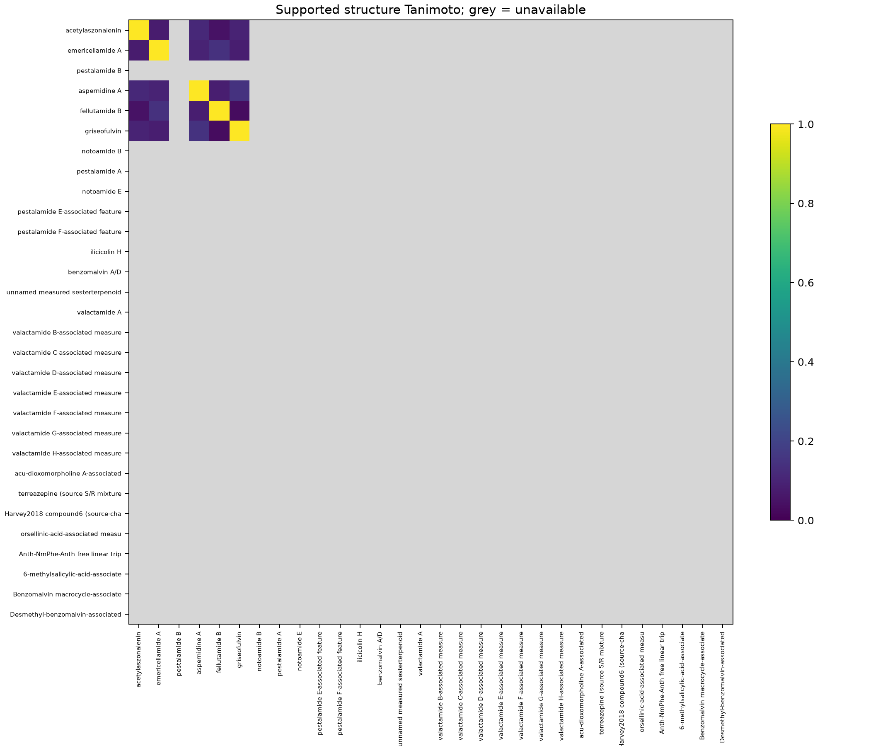

# Similarity and dependence in the retained benchmark

Analysis completed 11 October 2026 under `protocol/similarity-independence-v1.md`. This companion analysis preserves 30 admitted relationships, 16 query identities and coverage of 11 complete, two partial and 17 missing. No labels, retrieval scores, frozen groups or release ZIPs changed.

Five source-specific BGC/product crosswalks support machine-readable connectivity representations: acetylaszonalenin, emericellamide A, griseofulvin, fellutamide B and aspernidine A. All ten eligible pairs were computed; the other 425 relationship pairs are unavailable. Their Morgan Tanimoto values range from 0.0323 to 0.1463; none reaches 0.7. This sparse subset cannot establish that the entire benchmark is chemically diverse. Source keys omit stereochemical distinctions present in supplied SMILES, so chiral sensitivity is withheld pending source-level reconciliation. Formula strings were calculated; independent source formula checks are unavailable. No source drawings were transcribed, no proposed valactamide structures were invented and benzomalvin A/D remains an unresolved set without machine-readable alternatives.

The genomic analysis covers all 79 displayed members and 1209 proteins in seven source-selected GCFs, plus 10 accepted locus/construct/CDS anchors containing 43 annotated proteins. Of 10516 cross-member core pair records, 3575 have compatible source-annotated roles and numerical alignments. Incompatible roles remain null. The family summary gives within/between distributions, represented member-pair counts, extremes and identity/coverage screens. Reciprocal best ties and gene order are retained across bounded member pairs, including accepted anchors. Fractions use all displayed annotated proteins as denominators but only source-annotated cores in the numerator, so they are lower bounds on qualifying protein content, not estimates of whole-cluster similarity. Unclassified proteins cannot establish dissimilarity. Reference intervals, construct envelopes, native/reference windows and single CDS are labeled separately; sequence similarity does not validate a biological link. Saved griseofulvin, notoamide, acetylaszonalenin and Trichoderma correspondence records are reused with their original scope. Integer identity/coverage arithmetic was checked independently where retained.

All 91 Trichoderma and 291 black-yeast native joined exports survived preprocessing. There are 4,095 and 42,195 within-pool pairs respectively, totaling 46,290. The 26,481 cross-pool pairs are excluded because explicit native-export charges are positive and negative respectively. 93 pairs meet cosine >=0.7 with at least six matched peaks; 51 meet 0.9. These are resemblance flags, not new chemical assignments. Native event memberships, selected unmerged scan IDs and source collision-energy values (20 for Trichoderma; 40 for black yeast, units not recorded in the consumed receipts) are retained in `spectral-provenance.tsv`; unknown instrument/energy fields stay unknown. Shared source events are recorded separately from exact peak-list duplication. The selected exported scans are verified against retained native peak-rounding receipts. None supplies historical Caesar native joins. The remaining seven Trichoderma and 958 black-yeast candidate spectra remain unavailable.

Eight valactamide relationships share one query and four benzomalvin relationships share another. Their three AtFAC9J20 locus envelopes share a construct/host context but are not one pathway. Typed edges preserve this distinction. The grouping tables include query/pathway, construct-context, conservative-design and similarity sensitivity scenarios. Each row prints its merger edge IDs and frozen parent group. `not_adjudicated` is never treated as evidence of a shared or distinct pathway. Exact acquisition IDs come from the retained observation/member eligibility ledgers, without inferring independent cultures from assembly strings.

The conservative design scenario has 5 components, only 1 containing complete evaluated relationships. These are grouping scenarios, not independent replicates. A future grouped holdout is not established: the one frozen complete-analysis group remains intact, and other components lack complete evaluated inputs. Between-group uncertainty cannot be estimated from that single complete group.

The exposure table separates source/label selection, exact unversioned BGC membership in declared public-reference files and weight-specific training membership. It records deterministic method version 0.1.0, strict NPClassScore implementation 1.0.0 and its inspected upstream NPLinker 1.2.0 separately. Asset versions identify the MIBiG 2.0 table or retained model-repository revisions; missing semantic versions stay unknown. The five supported structure crosswalks supply bounded stable-ID checks. The complete pinned class-table file is not a complete training roster; Rosetta's mapping is reference context and no Rosetta experiment was run. Actual positive/negative Spec2Class execution receipts identify the consumed weight hashes, while their weight-specific training membership remains unknown. Deterministic controls have no learned training set but retain retrospective source-selection exposure. No no-match status means unexposed.

Software checks cover all 30 IDs, 435 chemical relationship pairs, 72,771 spectral pairs, null-versus-zero values, pair ordering, exact duplicate fixtures, an independent bit intersection/union fixture, hand-counted alignment arithmetic, a cosine fixture of 0.48, sparse-peak filtering and alternative-set ranges. Repeated fixture results and input hashes are recorded in the work receipts. Automated checks do not replace chemical or biological review; that review remains pending. The analysis provides no new evidence that an unresolved genome-product link is false.

Reproduction: use the recorded environment, then run `python scripts/similarity_independence.py --stage all`, `python -m scripts.similarity_locus_anchors`, and `python -m scripts.finalize_similarity_independence`. Existing alignment caches are resumable only under the frozen settings and sequence hashes. Results and exact consumed-input hashes are in `data/processed/similarity-independence-v1/manifest.json`.
